# Database ERD (P3)

**Status: FROZEN (L-033, 2026-11-01)** from the three P2 entity inventories: gas `docs/research/v2/gas.md` §5-6,
power `power.md` §4, weather `weather.md` §10. The vocabularies are in [Frozen vocabularies](#frozen-vocabularies).
After the freeze, a change is a numbered migration plus a LOG entry, never an edit here alone. Engine: PostgreSQL 18 + TimescaleDB 2.31
(L-002, [`INSTALL.md`](INSTALL.md)). Retention policies and the size budget: [`RETENTION.md`](RETENTION.md).

## Principles

- **v1's long-table model stays.** A value is `(series, ts, as_of) → value`. There's no table per source, and a new
  source is still just a YAML spec.
- **Tables are split by retention tier, not by source.** Timescale's retention and compression policies act on
  whole chunks of a hypertable. A daily series kept forever and a 5-minute series kept 60 days can't share one
  hypertable unless every delete is a row-level `DELETE` inside compressed chunks, which is slow and churns WAL.
  So observations live in four tier hypertables with identical columns, and a view (`observation`) unions them
  for readers.
- **Small keys.** `series.id` is an `int4` surrogate. The v1 text id (`ngtl.gdsr.empress.flow`, about 25 bytes)
  lives once in `series.key`. The API keeps speaking text ids.
- **Times are naive UTC** (`timestamp`, not `timestamptz`), as in v1 (AGENTS.md).
- Everything lives in schema `montney`. Migrations are plain numbered SQL ([`INSTALL.md`](INSTALL.md#migrations)).

## Diagram

```mermaid
erDiagram
    region ||--o{ source : "budgeted in"
    region ||--o{ series : "budgeted in"
    region ||--o{ entity : "located in"
    source ||--o{ fetch_run : "runs"
    source ||--o{ series : "declares"
    source ||--o{ event : "publishes"
    source ||--o{ raw_blob : "fetched"
    series ||--|| series_state : "last seen"
    series ||--o{ obs_fast : "5-30 min points"
    series ||--o{ obs_hourly : "hourly points"
    series ||--o{ obs_daily : "daily+ points"
    series ||--o{ obs_forecast : "forecast vintages"
    series ||--o{ forecast_latest : "newest vintage per ts"
    series ||--o{ obs_flag : "sparse quality flags"
    entity ||--o{ series : "measured at"
    entity ||--o{ entity : "parent"
    entity ||--o{ entity_alias : "known as"
    entity ||--o{ entity_link : "from"
    entity ||--o{ entity_link : "to"
    event ||--o{ event_scope : "applies to"
    entity |o--o{ event_scope : "resolved ref"
    fetch_run ||--o{ raw_blob : "payload"

    region {
        int2 id PK
        text code UK "ab_nebc | rest"
        text name
        int8 budget_bytes "5 GB | 95 GB"
        int2 warn_pct "80"
    }
    source {
        int2 id PK
        text code UK "spec id, e.g. ngtl_gdsr"
        text name
        int2 region_id FK
        text retention "spec default tier"
        int4 interval_s
        text mode "cached | live"
        text spec_sha "detects spec edits"
        text budget_state "ok | warn | blocked"
        timestamp last_ok_at
    }
    fetch_run {
        int8 id PK
        int2 source_id FK
        timestamp started "plain table"
        timestamp finished
        bool ok
        int4 n_written
        int4 n_unchanged "skipped by change-only"
        int4 bytes_in
        text error
    }
    series {
        int4 id PK
        text key UK "v1 series_id"
        int2 source_id FK
        int4 entity_id FK "nullable"
        int2 region_id FK
        text label
        text unit
        text freq "5min | 1h | D | M ..."
        text day "'' | gas"
        text tier "fast | hourly | daily | forecast"
        jsonb attrs
    }
    series_state {
        int4 series_id PK
        timestamp last_ts
        timestamp last_as_of
        float8 last_value
        timestamp last_seen_at "updated on every fetch"
    }
    obs_fast {
        int4 series_id PK
        timestamp ts PK "hypertable time"
        timestamp as_of PK
        float8 value
        timestamp fetched_at
    }
    obs_hourly {
        int4 series_id PK
        timestamp ts PK "hypertable time"
        timestamp as_of PK
        float8 value
        timestamp fetched_at
    }
    obs_daily {
        int4 series_id PK
        timestamp ts PK "hypertable time"
        timestamp as_of PK
        float8 value
        timestamp fetched_at
    }
    obs_forecast {
        int4 series_id PK
        timestamp as_of PK "hypertable time = run"
        timestamp ts PK
        float8 value
        timestamp fetched_at
    }
    obs_flag {
        int4 series_id PK
        timestamp ts PK
        timestamp as_of PK "flags are per vintage"
        text flag PK "e.g. hv_fallback"
        text note
    }
    forecast_latest {
        int4 series_id PK
        timestamp ts PK
        timestamp as_of "newest written vintage"
        float8 value
    }
    entity {
        int8 id PK
        text type "frozen list, CHECK"
        text key UK "id grammar, CHECK"
        text name
        int8 parent_id FK
        int2 region_id FK
        float8 lon
        float8 lat
        jsonb geometry "GeoJSON for lines/areas"
        jsonb attrs
        date valid_from
        date valid_to
    }
    entity_alias {
        text system PK "frozen list, CHECK"
        text alias PK
        date valid_from PK
        int8 entity_id FK
        date valid_to
    }
    entity_link {
        int8 id PK
        int8 from_id FK
        int8 to_id FK
        text kind "frozen list, CHECK"
        float4 confidence "0..1"
        text method "how the link was made"
        jsonb evidence
        jsonb attrs "role, distance_km, split_method"
        date valid_from
        date valid_to
    }
    event {
        text id PK "source:native id"
        int2 source_id FK
        text kind "outage | bulletin | notice | alert | cargo"
        text title
        text body
        text url
        timestamp starts
        timestamp ends
        text severity
        timestamp published
        jsonb extra
        timestamp first_seen
        timestamp updated
        text status "active | withdrawn"
        bytea content_sha1
    }
    event_scope {
        text event_id PK
        text ref PK "network feature id"
        int8 entity_id FK "nullable"
    }
    raw_blob {
        int8 id PK
        timestamp fetched_at PK "hypertable time"
        int2 source_id FK
        int8 fetch_run_id
        text content_type
        bytea sha256
        int4 bytes_raw
        bytea payload "zstd, null if same sha as previous"
    }
```

Plus `schema_migration(version int4 PK, name text, sha256 text, applied_at timestamp)`, the migration ledger, and
`usage_snapshot` (see [`RETENTION.md`](RETENTION.md#budget-accounting-montney-du)).

## Tables

Chunk intervals and compression ages are first guesses. They're sized so a chunk holds roughly 0.1-2 M rows at
today's rates. They'll be re-derived from measured sizes after the install. Every number in this section can
change before the freeze.

### Dimension tables (plain Postgres)

| table | keys | indexes | retention |
|---|---|---|---|
| `region` | PK `id`, UK `code` | none | forever. Seeded with `ab_nebc` (5 GB) and `rest` (95 GB) by migration |
| `source` | PK `id`, UK `code` | `region_id` | forever. Upserted from `sources/*.yaml` at runner start |
| `series` | PK `id`, UK `key` | `source_id`, `entity_id`, `(region_id, tier)` | forever. Upserted from the spec and connector meta |
| `series_state` | PK `series_id` (FK) | none | forever, one row per series. Updated on every fetch, including when nothing is written |
| `forecast_latest` | PK `(series_id, ts)` | none | rows with `ts` more than 1 day in the past are deleted by the thinning job. Size is about the number of future forecast points (tens of thousands) |
| `fetch_run` | PK `id` (identity) | `(source_id, started DESC)` | 1 year, by a daily `DELETE` job (`prune_fetch_runs`). It's small (~2,000 rows/day, ~70 MB/yr), so it's a plain table: a hypertable would need the time column in its PK, and nothing here needs chunk drops |
| `entity` | PK `id`, UK `key` | `(type)`, `parent_id`, `region_id`, `(lon, lat)` btree | forever. Entities are never deleted, only closed with `valid_to` |
| `entity_alias` | PK `(system, alias, valid_from)` | `entity_id` | forever |
| `entity_link` | PK `id`, UK `(from_id, to_id, kind, valid_from)` | `to_id`, `(kind)` | forever. Re-running a matcher closes old links (`valid_to`) and doesn't delete them. Gas re-scores station links monthly, so a changed score is a new version |
| `obs_flag` | PK `(series_id, ts, as_of, flag)` | none | Sparse quality flags on one observation **vintage**, e.g. `hv_fallback` when a delivery was converted with the fallback heat value (L-031). A flag belongs to the vintage, so a re-issued month converted with the published HV is a new vintage with no flag, and it doesn't inherit the old one. **A flag lives exactly as long as its observation row.** When tier retention drops or thinning deletes the row, the daily job `prune_obs_flags` deletes its flags too. `db check` reports orphan flags. In practice `hv_fallback` sits on monthly series in `obs_daily`, which is kept forever. Kept out of the observation rows so they stay lean |
| `event` | PK `id` | `(source_id, kind, status)`, `coalesce(published, first_seen) DESC`, `updated` | **forever** (ruled: L-029). `montney du` counts them; revisit if events pass 1 % of a region's budget |
| `event_scope` | PK `(event_id, ref)` | `ref`, `entity_id` | dies with its event (`ON DELETE CASCADE`) |
| `schema_migration` | PK `version` | none | forever |

**Notes.** Change-only writes compare each incoming point with **the latest stored vintage of the same
`(series, ts)`**. That's the one comparator; the details and the tests are in
[`RETENTION.md`](RETENTION.md#change-only-writes). `forecast_latest` holds that value for forecast points, so
the check (and the snapshot's "current forecast") never reads old `obs_forecast` chunks. `series_state` is
**not** a comparator: it holds only the newest point per series. It keeps staleness and "last fetched" right,
because `last_seen_at` moves on every fetch, even when an unchanged value writes no row. `event_scope` replaces v1's `refs VARCHAR[]`. `event_scope.entity_id` gets
filled when a ref resolves to an entity (P5).

### Hypertables

All four observation tables have identical columns:
`(series_id int4, ts timestamp, as_of timestamp, value float8, fetched_at timestamp)`. Columns are ordered so
the 8-byte fields come first, which avoids padding in the heap tuple.

| table | time column / chunk | PK (also the only index) | compression | retention / downsampling |
|---|---|---|---|---|
| `obs_fast` (freq < 1 h: 5, 10, 15, 30 min) | `ts`, 1 day | `(series_id, ts, as_of)` | after 2 days; `segmentby series_id`, `orderby ts, as_of` | raw dropped after 60 days. Continuous aggregate `obs_fast_1h` kept 2 years, then `obs_fast_1d` forever |
| `obs_hourly` (freq 1 h up to < 1 D) | `ts`, 7 days | `(series_id, ts, as_of)` | after 7 days, same settings | raw dropped after 2 years. Continuous aggregate `obs_hourly_1d` forever |
| `obs_daily` (freq D, M and longer) | `ts`, 365 days | `(series_id, ts, as_of)` | after 90 days (gas-day revisions settle long before) | forever |
| `obs_forecast` (`as_of: fetch` series) | **`as_of`**, 1 day | `(series_id, as_of, ts)` | after 15 days, once thinned; `segmentby series_id`, `orderby as_of, ts` | all runs for 14 days, then thinned to one run per day by the job `thin_forecasts`; chunks dropped after 1 year + 7 days (on `as_of`). An unchanged point is re-anchored every 7 days, so long-horizon forecasts always keep a recent vintage ([RETENTION.md](RETENTION.md#re-anchoring-long-horizon-forecasts)) |
| `raw_blob` | `fetched_at`, 1 day | PK `(id, fetched_at)` (a hypertable's unique keys must include its time column) and `(source_id, fetched_at DESC)` | none (payload is already zstd; column storage `EXTERNAL`, so TOAST doesn't compress twice) | dropped after 7 days |

**Notes.**
- `obs_forecast` is partitioned on `as_of` (the run time), not `ts`, so "drop runs older than a year" is a
  plain chunk drop, and the 14-day thinning touches only one uncompressed chunk per day.
- A series' tier comes from the spec's `retention:` (see [`RETENTION.md`](RETENTION.md#spec-contract)). CI
  checks that it's consistent with the series' `freq` and `as_of`. **A series' tier is fixed once it has
  rows.** Moving it means a numbered migration that copies its rows, not a spec edit. The runner refuses to
  start if a spec's tier disagrees with `series.tier`.
- **Tier hypertables: accepted for the draft (ruled: L-029).** The split is by retention class, not by
  source, so "no table per source" still holds. One table can't work because chunk drops can't give
  per-series lifetimes.
- A daily series with revisions (NGTL GDSR, `as_of` from the report) belongs in `obs_daily`, not the forecast
  tier. Its vintages are real revisions, and change-only writes stop a re-fetch from adding rows.
- **No foreign keys from the observation hypertables, by choice.** Timescale allows an FK from a hypertable
  to a plain table such as `series`. We skip it because it costs an index probe on every inserted row, at
  ~150k rows/day. `series_id` is checked by the runner instead (it resolves keys through `series`), and
  `db check` finds orphans. Low-volume tables (`raw_blob`, `event_scope`, `entity_*`) do get their FKs.

### Read side

- **`observation` (view)** is the union of the four tier tables, with **v1's column names exactly**:
  `series_id` (text, = `series.key`), `ts`, `value`, `as_of`, `fetched_at` (L-029). Snapshot/server queries
  then port mechanically. The API (orchestrator-owned `server.py`/`snapshot.py`) can move to tier-aware
  queries later, through a contract.
- **`observation_best(series_key, start, end, as_of_max)` (SQL function)** returns the latest vintage per
  `ts`. It reads raw rows where they still exist and falls back to `*_1h`/`*_1d` aggregates for older ranges.
  For a range that crosses tiers it states the resolution in a `res` column, so a chart can tell.
- **Weather grids** stay files in `<home>/grids/` with their pointer files (v1 `grids.py`, orchestrator-owned).
  They're current + previous run only, and they're regenerated from NOAA, so they're excluded from backups.
  `montney du` counts the files toward the region budget. **`grid_run`** (ruled: L-029) is a plain metadata
  table: `grid_run(var text, run timestamp, fetched timestamp, path text, bytes int8)`, PK `(var, run)`.
  The payloads stay files.

## Mapping from v1 (DuckDB)

| v1 | v2 |
|---|---|
| `observations` | `obs_fast` / `obs_hourly` / `obs_daily` / `obs_forecast` by tier; `series_id` text → `int4` |
| `series(series_id, source, label, unit, freq, grp, day)` | `series(key, source_id, label, unit, freq, day, tier, attrs{grp})` |
| `events.refs VARCHAR[]` | `event_scope` rows |
| `events.content` (sha1 hex) | `event.content_sha1 bytea` |
| `fetch_log` | `fetch_run` (+ `n_unchanged`, `bytes_in`) |
| `live_obs` (TEMP table, `mode: live`) | stays in memory in the runner. Proposal: the API reads live sources from a small `UNLOGGED` table `obs_live`, replaced on every fetch and never backed up |
| (none) | `source`, `region`, `series_state`, `forecast_latest`, `grid_run`, `entity*`, `raw_blob`, `schema_migration`, `usage_snapshot` |

## Frozen vocabularies

These lists are `CHECK` constraints in the first migration. Adding a value means a migration plus a LOG entry.

**Key grammar (L-033).** `entity.key` and `series.key` both match `^[a-z0-9_]+(\.[a-z0-9_]+)+$`: lowercase,
dot-separated, **no hyphens**. Native ids are kept verbatim as aliases. For example, Alberta Rivers `TAU-001`
is entity `gauge.tau_001` with alias `ab_station` = `TAU-001`, and its series is `abrivers.tau_001.outflow`. A
series id is its entity key plus a measure where an entity exists (`ngtl.station.31127.delivery` belongs to
`ngtl.station.31127`).

**`entity.type`** (15):

| type | key pattern | from |
|---|---|---|
| `station` | `ngtl.station.<tc_number>` (NGTL receipt/delivery; ATCO-linked stations share the number space); `cgl.receipt.<petrinex_id>` | gas |
| `segment` | `ngtl.segment.<code>` | gas |
| `area` | `gas.ngtl.<dop>` (v1 network ids) | gas |
| `facility` | `petrinex.<facility_id>` (gas plants, gathering systems, batteries, injection facilities; subtype in `attrs.subtype`) | gas |
| `operator` | `operator.<baid>` | gas |
| `well` | `well.ab.<uwi16>`, `well.bc.<wa_num>`. Entities only: per-well production is not stored (gas.md §6) | gas |
| `pipeline` | `pipeline.<petrinex_pl>` | gas |
| `terminal` | `lng.terminal.<slug>` | gas |
| `ship` | `ship.<imo>` | gas |
| `gen_unit` | `aeso.asset.<id>` | power |
| `plant` | `power.plant.<slug>` (v1 network ids) | power |
| `dam` | `dam.<slug>` (reservoir figures are attributes and series of the dam) | power, weather |
| `gauge` | `gauge.<id>` (WSC id lowercased; AB `TAU-###` → `tau_###`) | weather |
| `river` | `river.<slug>` | weather |
| `reach` | `reach.<river>.<from>_<to>` | weather |

Power's `ngtl_station` is `station`. A cargo is an **event** (`kind = cargo`, id `ppa:<jobOrderId>`,
`event_scope` → the terminal), not an entity.

**`entity_alias.system`** (21). Values are kept verbatim (case, hyphens):

| system | value | entity types |
|---|---|---|
| `tc_station` | TC station number, as published (string) | station |
| `petrinex_facility` | Petrinex/AER facility id: `ABMS…`/`BCMS…` meter stations, `ABGP…` plants, `ABPL…` pipelines, `BCLN…` | station, facility, pipeline, terminal |
| `bcer_facility` | BCER 8-digit facility id | facility, terminal |
| `petrinex_ba` | AB 4-char BAID / BC 5-digit code | operator |
| `tc_segment` | TC segment number 1-28 | segment |
| `tc_dop_area` | DOP area acronym | area |
| `uwi` | DLS or NTS UWI | well |
| `bc_wa` | BC well authorization number | well |
| `well_licence` | licence number | well |
| `imo`, `mmsi` | ship ids | ship |
| `ppa_berth` | Pacific Pilotage Authority berth code | terminal |
| `aeso_asset` | AESO asset id (`EGC1`) | gen_unit |
| `ghgrp`, `npri` | federal reporting facility ids | plant |
| `bch_code` | BC Hydro plant or hydromet code | dam, gauge |
| `usace` | USACE location code | dam |
| `wsc_station` | Water Survey of Canada station (`07FA004`) | gauge |
| `ab_station` | Alberta Rivers station (`05BE005`, `TAU-001`) | gauge, dam |
| `usgs_site` | USGS 8-digit site | gauge |
| `nhn` | National Hydro Network id (geometry) | river, reach |

L-033 says Petrinex/AER meter-station ids alias the station entity (`petrinex_ms`). That's the
`petrinex_facility` system here: Petrinex calls every one of them a facility id, and the `ABMS`/`BCMS` prefix
already marks a meter station. One system for one id space. Per-series ids such as WISKI `tsid` go in
`series.attrs`, not `entity_alias`. OSM ids for river geometry go in `entity.attrs` if they're used.

**`entity_link.kind`** (8). Direction is always from → to:

| kind | from → to | notes |
|---|---|---|
| `delivers_to` | gas moves from → to: facility → station (inferred, confidence 0.5-0.95), facility → facility (reported, 1.0), well → facility, station → plant (Power's `supplies_gas_to`), CGL station → terminal | confidence + method per gas.md §6 and power.md §1.3 |
| `member_of` | containment: station → segment, segment → area (partial: confidence < 1), station → pipeline, gen_unit → plant, reach → river | Power's and Weather's `part_of` |
| `operated_by` | facility → operator | |
| `generates_at` | plant → dam | `attrs.split_method` for many-to-one (BOW1 → 11 dams) |
| `measured_by` | dam → gauge | `attrs.role` = `release` / `forebay` / `inflow` / `downstream_proxy`; `attrs.distance_km` |
| `on_reach` | gauge → reach | |
| `flows_into` | reach → reach | the river network graph |
| `derived_from` | virtual gauge → gauge | `attrs.formula` (e.g. Peace Canyon ≈ 07FA004 − 07FA006 − 07FB008) |

**`event.kind`:** `outage`, `bulletin`, `notice`, `alert`, `cargo`.

**Revised monthly files (Petrinex).** Petrinex reissues monthly volumetrics in full. Each month the ingest
re-reads the trailing ~4 months, with `as_of` = the file's publication date. Change-only skips months that
didn't change, and a revised month lands as a new vintage in `obs_daily`. Nothing is overwritten in place, and
the as-of history is kept.

**Size check against the inventories.** Gas adds < 0.5 M history rows + ~30-40 k/yr. Weather adds ~0.8 M kept
rows/yr, ~3.3 M steady with the full HYDAT backfill. Power adds ~1 M hourly rows/yr + ~2 M live 5-min rows at
v1 scope (×2.5 for all 280 assets). All of it fits the tiers as designed. At ~10 B/row compressed that's well
under 0.5 GB on top of the RETENTION.md baseline, inside the 5 GB `ab_nebc` budget. Columbia/Kootenay (LATER)
goes to `rest`.

## Questions

- **Q-D1 PostGIS: ruled, L-029: no.** Entities carry `lon`/`lat` and GeoJSON in `jsonb`. Spatial matching
  (LSD → nearest station, P5) runs in Python. A migration adds PostGIS only if a real query needs it.
- **Q-D2 grid metadata: ruled, L-029: yes,** the `grid_run` table above. Files stay; `du` counts them.
- **Q-D3 event retention: ruled, L-029: keep forever.** `du` counts events; revisit above 1 % of a region's
  budget.
- **Q-D4: closed by the freeze (L-033).** The P2 entity inventories decided the `entity.type` list, the `entity_alias.system` list and the
  `entity_link.kind` list. Petrinex volumes are series on facility entities (`petrinex.<id>.sales_gas`).
